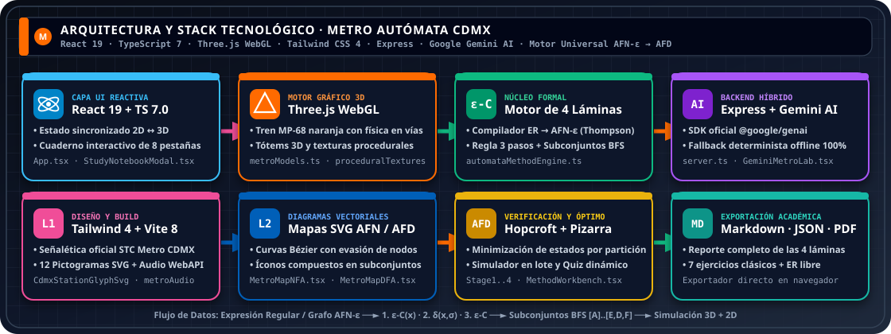
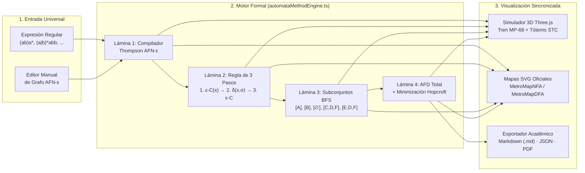
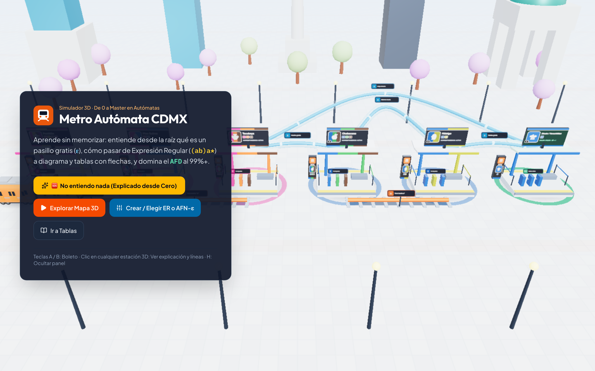
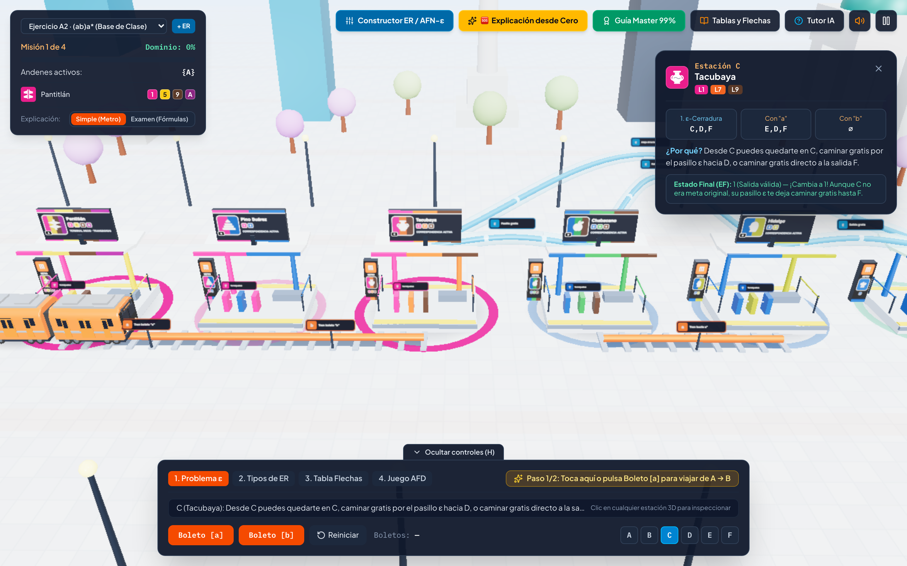
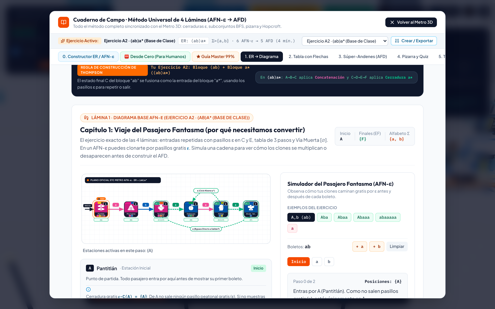
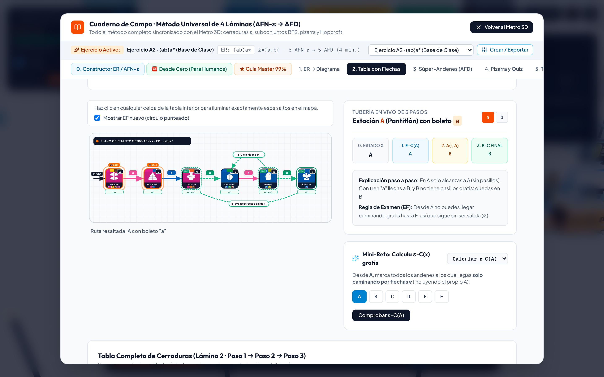
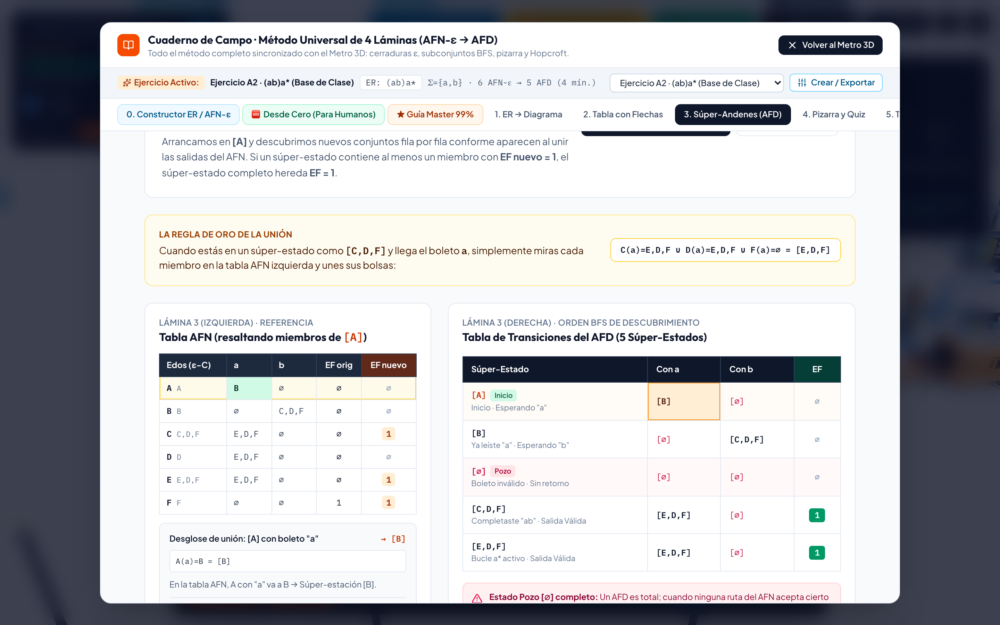
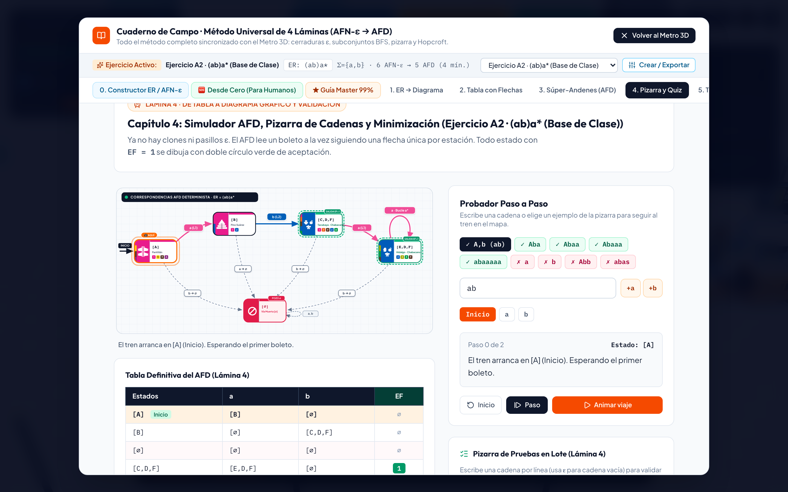
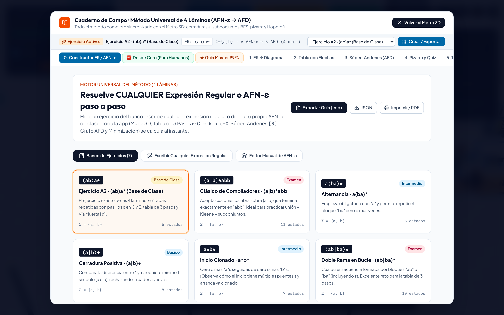

<div align="center">

# 🚇 Metro Autómata CDMX
### Simulador 3D WebGL y Motor Universal de Conversión $\text{ER} \to \text{AFN-}\varepsilon \to \text{AFD}$ (Método de 4 Láminas)

[](https://react.dev/)
[](https://www.typescriptlang.org/)
[](https://threejs.org/)
[](https://tailwindcss.com/)
[](https://vite.dev/)
[](https://expressjs.com/)
[](https://ai.google.dev/)

<p align="center">
  <strong>Aprende y resuelve cualquier autómata desde la raíz con señalética oficial del STC Metro CDMX:</strong><br/>
  Compilador de Thompson · Tabla de 3 Pasos ($\varepsilon\text{-C} \to \delta \to \varepsilon\text{-C}$) · Construcción de Subconjuntos BFS · Minimización de Hopcroft · Simulador 3D MP-68
</p>


</div>

---

## 🛠️ Stack Tecnológico y Arquitectura Visual



| Capa | Tecnología | Rol dentro de Metro Autómata CDMX | Archivos Clave |
| :--- | :--- | :--- | :--- |
| **Frontend Reactivo** | **React 19 + TypeScript 7** | Estado sincronizado entre el mundo 3D, el HUD táctil y el Cuaderno de Campo de 8 pestañas. | `src/App.tsx`, `src/components/StudyNotebookModal.tsx` |
| **Motor 3D WebGL** | **Three.js (`0.187`)** | Tren **MP-68** naranja animado sobre vías, estaciones 3D con tótems oficiales, pasillos $\varepsilon$ luminosos y texturas procedurales Canvas 2D. | `src/three/metroModels.ts`, `src/three/proceduralTextures.ts` |
| **Iconografía y Mapas 2D** | **SVG Vectorial + Tailwind CSS 4** | **12 pictogramas oficiales del STC Metro CDMX** (`Pantitlán`, `Pino Suárez`, `Tacubaya`, `Chabacano`, `Hidalgo`, `Zócalo`, `Bellas Artes`, etc.) + emblemas compuestos automáticos para súper-estaciones AFD (`[C,D,F]`, `[E,D,F]`). | `src/components/CdmxStationGlyphSvg.tsx`, `src/components/MetroMapNFA.tsx`, `src/components/MetroMapDFA.tsx` |
| **Motor Formal de Autómatas** | **TypeScript Puro (Zero-Deps)** | Compilador $\text{ER} \to \text{AFN-}\varepsilon$, cerradura-$\varepsilon$, tabla de 3 pasos, construcción de subconjuntos en orden BFS, estado pozo `[∅]` y minimización de Hopcroft. | `src/engine/automataMethodEngine.ts`, `src/data/automataData.ts` |
| **Audio Procedural** | **Web Audio API** | Sintetizador sin archivos externos: silbato de cierre de puertas del Metro CDMX, timbre de transbordo $\varepsilon$, validación de boleto y alerta de vía muerta `[∅]`. | `src/utils/metroAudio.ts` |
| **Tutor IA Híbrido** | **Express + `@google/genai`** | Servidor API con soporte para **Google Gemini AI** y motor determinista local 100% offline que explica paso a paso cualquier estado o transición del ejercicio activo. | `server.ts`, `src/components/GeminiMetroLab.tsx` |



---

## 📸 Capturas de Pantalla y Recorrido de Animaciones

### 1. Menú Principal y Simulador 3D con Iconografía Oficial del STC Metro CDMX
El entorno 3D renderiza en tiempo real cada estación con su **pictograma oficial del Metro CDMX**, sus franjas de correspondencia (`L1`, `L2`, `L3`, `L5`, `L7`, `L8`, `L9`, `LA`, `LB`), el tren **MP-68** en movimiento y el **Inspector Flotante 3D** al hacer clic sobre cualquier estación.

| Vista de Bienvenida 3D | Simulador 3D Interactivo + Inspector de Estación |
| :---: | :---: |
|  |  |

---

### 2. Lámina 1 y Lámina 2 · De Expresión Regular a AFN-$\varepsilon$ y Tabla de 3 Pasos
- **Lámina 1 (`Stage1Roots` + `MetroMapNFA`)**: Muestra las placas oficiales de cada estación (`A` Pantitlán, `B` Pino Suárez, `C` Tacubaya, `D` Chabacano, `E` Hidalgo, `F` Zócalo), el bucle superior $\varepsilon$ de Kleene (`E → D`), el puente inferior $\varepsilon$ de salida directa (`C → F`) sin cruzar etiquetas y el **Simulador del Pasajero Fantasma**.
- **Lámina 2 (`Stage2Closure`)**: Ilumina en vivo la **Tubería de 3 Pasos** ($\text{Estado } x \xrightarrow{\varepsilon\text{-C}} \text{Alcance gratis} \xrightarrow{\delta(\cdot,\sigma)} \text{Tren} \xrightarrow{\varepsilon\text{-C}} \text{Destino AFN}$) y marca automáticamente con `EF = 1` las estaciones que alcanzan la meta por pasillos $\varepsilon$.

| Lámina 1 · Mapa Oficial AFN-$\varepsilon$ y Pasajero Fantasma | Lámina 2 · Tubería Animada de 3 Pasos y Cerradura-$\varepsilon$ |
| :---: | :---: |
|  |  |

---

### 3. Lámina 3 y Lámina 4 · Construcción de Subconjuntos BFS, Correspondencias AFD y Constructor Universal
- **Lámina 3 (`Stage3Subset`)**: Compara lado a lado la **Tabla Resumen AFN** (izquierda) con la **Tabla de Transiciones del AFD** (derecha) descubierta en orden BFS (`[A]`, `[B]`, `[∅]`, `[C,D,F]`, `[E,D,F]`), mostrando la fórmula exacta de unión para cada celda.
- **Lámina 4 (`Stage4Simulator` + `MetroMapDFA`)**: Renderiza las **Súper-Estaciones de Correspondencia AFD** con **pictogramas compuestos** (trío `Tacubaya · Chabacano · Zócalo` en `[C,D,F]` e `Hidalgo · Chabacano · Zócalo` en `[E,D,F]`), animador paso a paso de cadenas, pizarra de pruebas en lote y **Minimización de Hopcroft**.
- **Constructor Universal (`MethodWorkbench`)**: Incluye un banco de **7 ejercicios clásicos**, un compilador para escribir **cualquier Expresión Regular** y un editor manual de estados/transiciones con exportación directa a **Markdown (`.md`)**, **JSON** o **PDF**.

| Lámina 3 · Construcción de Subconjuntos (Orden BFS) | Lámina 4 · Diagrama AFD de Correspondencias y Pizarra |
| :---: | :---: |
|  |  |

<div align="center">

#### Constructor Universal $\text{ER} / \text{AFN-}\varepsilon$ y Exportador de Guía Completa


</div>

---

## 🏛️ Catálogo de Estaciones Oficiales del STC Metro CDMX en el Simulador

| Estado | Estación Oficial STC | Pictograma Oficial | Líneas de Correspondencia | Rol en el Ejercicio Base `(ab)a*` |
| :---: | :--- | :--- | :---: | :--- |
| **`A`** | **Pantitlán** | Dos postes ceremoniales con 4 banderas ondeando | `L1` `L5` `L9` `LA` | Estación Inicial (`ε-C(A) = {A}`) |
| **`B`** | **Pino Suárez** | Pirámide circular del Adoratorio de Ehécatl | `L1` `L2` | Escala tras leer boleto `a` (`ε-C(B) = {B}`) |
| **`C`** | **Tacubaya** | Cántaro prehispánico de agua con asas | `L1` `L7` `L9` | Fin del prefijo `ab` y bifurcación $\varepsilon$ (`ε-C(C) = {C,D,F}`, `EF = 1`) |
| **`D`** | **Chabacano** | Chabacano con hendidura central y hoja | `L2` `L8` `L9` | Entrada del bucle `a*` (`ε-C(D) = {D}`) |
| **`E`** | **Hidalgo** | Silueta en perfil de Miguel Hidalgo | `L2` `L3` | Fin de repetición `a` con retorno $\varepsilon \to D$ y salida $\varepsilon \to F$ (`ε-C(E) = {E,D,F}`, `EF = 1`) |
| **`F`** | **Zócalo / Tenochtitlan** | Escudo Nacional Mexicano (Águila sobre nopal) | `L2` | Torniquete de Salida Original (`EF = 1`) |
| **`[C,D,F]`** | **Tacubaya · Chabacano · Zócalo** | Emblema triple compuesto (`C + D + F`) | `L1` `L7` `L9` `L2` `L8` | Súper-Estación AFD al completar `"ab"` (`SALIDA EF = 1`) |
| **`[E,D,F]`** | **Hidalgo · Chabacano · Zócalo** | Emblema triple compuesto (`E + D + F`) | `L2` `L3` `L8` `L9` | Súper-Estación AFD con bucle `a*` activo (`SALIDA EF = 1`) |
| **`[∅]`** | **Vía Muerta / Aduana** | Símbolo de prohibición / desvío sin retorno | — | Estado Pozo / Trampa Total del AFD (`POZO ∅`) |

*(Para autómatas de hasta 12 estados se incluyen también los pictogramas oficiales de **Bellas Artes**, **Balderas**, **Insurgentes**, **Universidad**, **Salto del Agua** y **San Lázaro**).*

---

## 🚀 Instalación y Ejecución Local

```bash
# 1. Clonar el repositorio
git clone https://github.com/LuisandovalU/Automatas.git
cd Automatas

# 2. Instalar dependencias
npm install

# 3. Iniciar servidor de desarrollo (Frontend Vite + API Express en http://localhost:3000)
npm run dev

# 4. Verificar tipos de TypeScript
npm run lint

# 5. Generar build de producción
npm run build
```

> **Nota opcional sobre IA (`GEMINI_API_KEY`)**: Si deseas activar respuestas generativas en vivo desde Google Gemini en la pestaña `5. Tutor ¿Por qué?`, crea un archivo `.env` con `GEMINI_API_KEY=tu_api_key`. Si no se configura, la aplicación utiliza automáticamente su **motor determinista local integrado** sin requerir conexión ni claves externas.
